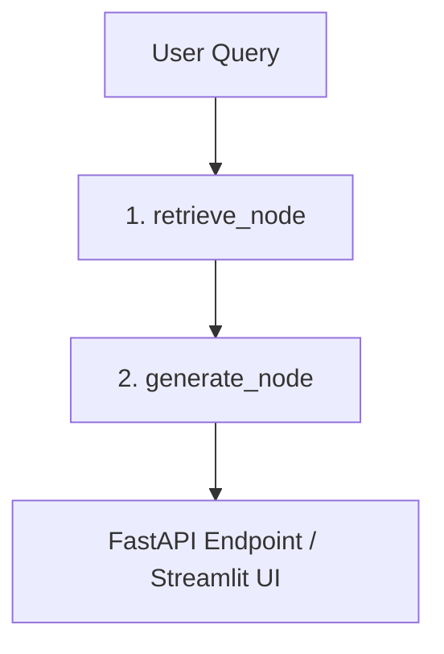
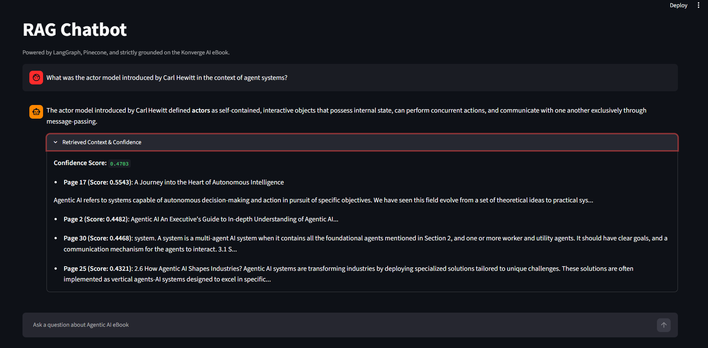

The service implements a directed, state managed RAG pipeline designed around three layers:

Data ingestion, Graph driven orchestration, Service delivery

## Architecture & System Workflow

The system is orchestrated using a deterministic **LangGraph State Workflow**, routing data through execution blocks to ensure strict context grounding and prevent hallucinations.





### Execution Pipeline

```text
        User Query
              │
              ▼

              LangGraph State Workflow

  1. retrieve_node
     - Embeds query using FastEmbed (all-MiniLM-L6-v2)
    - Queries Pinecone Serverless
    - Fetches Top 4 Chunks + Metadata + Scores
                        │
                        ▼
  2. generate_node
     - Formats retrieved chunks with page citations
     - Injects context into strict grounding prompt
     - Evaluates with Groq LLM

                         │
                         ▼
         FastAPI Endpoint and Streamlit UI
   Returns: final_answer, retrieved_context_chunks,
            confidence_or_score
```

---

Installation & Environment Setup:

```bash
git clone https://github.com/AnujPatil05/RAGchatbot
cd appening-agentic-rag

Create virtual environment:

python -m venv venv

.\venv\Scripts\Activate.ps1

source venv/bin/activate

pip install -r requirements.txt

python -m src.ingestion

python -m uvicorn main:app --reload

streamlit run app.py
```
